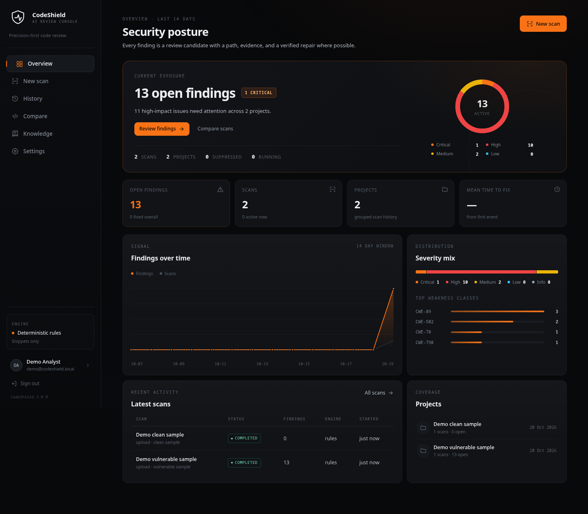
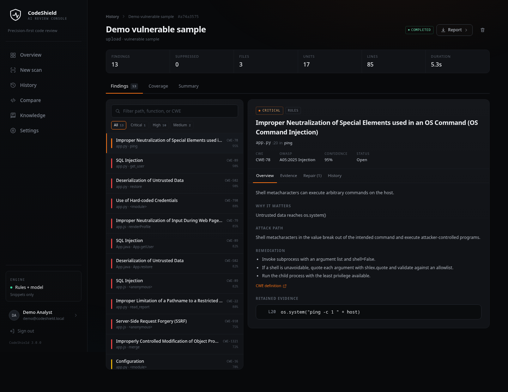
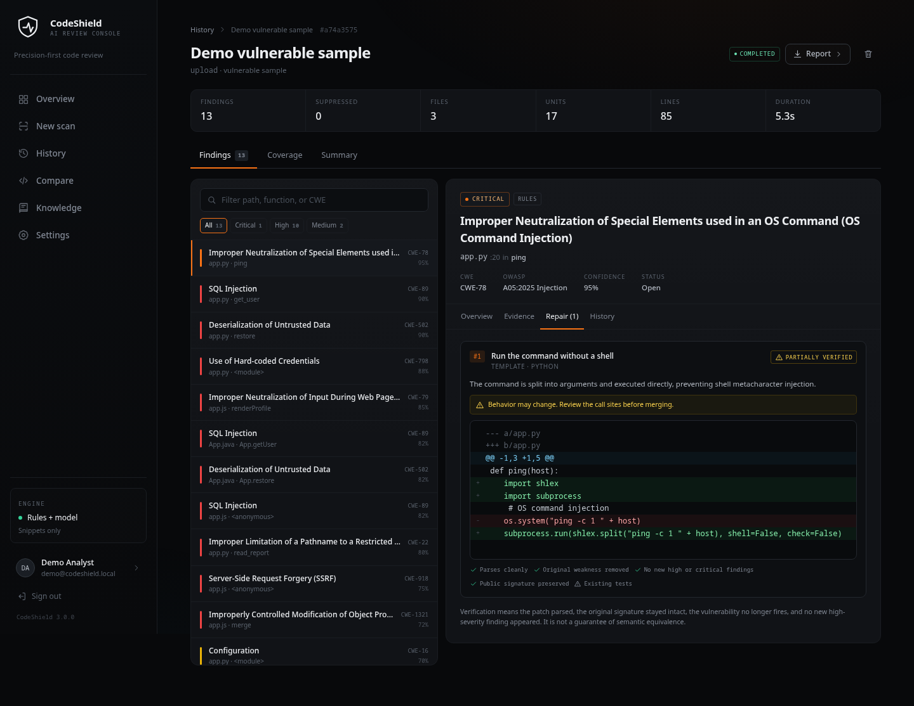

# CodeShield AI

**Self-hosted application security review for source code.** Deterministic analysis,
scoped taint tracking, optional CodeBERT detection, knowledge-grounded explanations,
and repairs that are verified before they are recommended.

[](https://github.com/Codeenk/CODESHIELD-AI/actions/workflows/tests.yml)




CodeShield AI is a complete security review console for Python, JavaScript,
TypeScript, and Java. It ingests real source code, identifies review candidates with
deterministic rules and scoped taint analysis, explains the path behind each result,
proposes patches, and re-parses and re-scans every candidate before ranking it.

It is an AI-powered source code security system designed to detect software
vulnerabilities, explain their causes, and recommend potential fixes. Traditional security tools
may generate false positives and provide limited explanations, increasing the manual effort
required for code review. Inspired by research such as CodeBERT, Devign, and LineVul[6], the
proposed system combines Python AST and Tree-sitter parsing with deterministic security rules
and optional CodeBERT analysis to identify potential vulnerabilities. Qwen2.5-Coder or
predefined templates are used to generate candidate fixes, which are then verified through rescanning. A web-based dashboard developed using React, FastAPI, and SQLite displays
vulnerability details, code highlights, suggested fixes, and security reports. Project validation
reports 13 findings across three vulnerable sample files, zero findings in a clean sample, and 56
automated tests. One model-assisted test reported 97% confidence; however, these preliminary
results do not establish overall detection accuracy. CodeShield AI aims to simplify vulnerability
analysis, improve explainability, and support developers in resolving security issues efficiently.

Rules-only scanning works without a model, GPU, or network. CodeBERT detection and
local LLM repair are optional layers. When those components are absent or fail,
scanning continues and the API reports what was and was not used.

> CodeShield is decision support, not certification. Findings are review candidates,
> not proof of exploitability. Every patch requires human review before merge.

## Contents

- [Overview](#overview)
- [Capabilities](#capabilities)
- [Coverage](#coverage)
- [How a scan works](#how-a-scan-works)
- [Interface](#interface)
- [Quick start](#quick-start)
- [Optional local models](#optional-local-models)
- [Command line](#command-line)
- [REST API](#rest-api)
- [Configuration](#configuration)
- [Security and privacy](#security-and-privacy)
- [Deployment](#deployment)
- [Testing and validation](#testing-and-validation)
- [Performance and hardware](#performance-and-hardware)
- [Project layout](#project-layout)
- [Limitations](#limitations)
- [Documentation](#documentation)
- [Attribution](#attribution)

## Overview

Most code scanners produce one of two failure modes: high-volume pattern matches with
little context, or opaque model verdicts that cannot be reviewed. CodeShield takes a
narrower position:

1. A finding must point to concrete evidence in a function.
2. A model may increase confidence, but rules remain the source of truth by default.
3. A repair is not shown as recommended until it survives verification.
4. The product must remain useful when models, Docker, or the network are unavailable.

The result is a local-first review console that is useful on a laptop, in CI, or on a
single internal server without a managed security platform.

### Design principles

| Principle | Implementation |
| --- | --- |
| Precision over volume | A self-scan of this repository produces zero findings while the vulnerable fixture produces thirteen |
| Evidence over verdicts | Every finding retains path, function, line, evidence snippets, AST citations, and a CWE/OWASP mapping |
| Verify before recommending | Patch candidates are re-parsed, re-scanned for the original CWE, checked for new high-risk findings, and tested when enabled |
| Local by default | No telemetry; code stays on the host unless it is sent to an explicitly configured external repair endpoint |
| Graceful degradation | Rules run without PyTorch, model weights, llama.cpp, or network access |

## Capabilities

| Area | What is implemented |
| --- | --- |
| Ingestion | Snippet, file upload, bounded `.zip`, and shallow clone of allowlisted public HTTPS repositories |
| Parsing | Python `ast`; Tree-sitter for JavaScript, TypeScript, TSX, and Java; tolerant fallbacks for unsupported syntax |
| Detection | 38 deterministic rules with scoped taint tracking, source/sink evidence, and deduplication by path, CWE, and line |
| Learned signal | Optional CodeBERT classifier with confidence fusion and attention-rollout line attribution |
| Explanations | CWE and OWASP context, attack path, remediation guidance, evidence, and references grounded in the vendored knowledge base |
| Repair | Deterministic language-aware templates plus optional Qwen/OpenAI-compatible generation |
| Verification | Syntax, original weakness removed, no new high/critical finding, signature preservation, and optional project tests |
| Tracking | Stable fingerprints, project grouping, status workflow, suppression, audit events, and scan-to-scan comparison |
| Reporting | JSON, SARIF 2.1.0, standalone HTML, and PDF |
| Access control | Local accounts, optional GitHub OAuth, CI bearer tokens, HttpOnly sessions, and rate-limited login |
| Privacy | Function bodies discarded by default, secret masking, bounded ingestion, and no code execution unless tests are enabled |
| Operations | SQLite WAL, background jobs, health and metadata endpoints, Docker image, compose file, and CI |

## Coverage

### Languages

| Language | Parser | Finding coverage |
| --- | --- | --- |
| Python | Standard-library `ast` | Full rule set, taint tracking, imports, assignments, guards |
| JavaScript | Tree-sitter | Rule set for injection, XSS, secrets, crypto, traversal, SSRF, and prototype issues |
| TypeScript / TSX | Tree-sitter | Same rule families with TypeScript syntax |
| Java | Tree-sitter | Rule set for SQL injection, command execution, deserialization, secrets, crypto, and TLS |

### Finding classes

The rule catalog covers SQL injection, command injection, path traversal, server-side
request forgery, cross-site scripting, insecure deserialization, hard-coded
credentials, weak hashing and encryption, disabled TLS verification, insecure random
number generation, permissive CORS, debug configuration, prototype pollution,
open redirects, XML external entities, unsafe YAML loading, and related CWE families.
The current build exposes 38 rules and 29 vulnerability knowledge modules through
`GET /api/v1/meta`.

### Deliberately out of scope

CodeShield does not scan dependency manifests, container images, cloud
configuration, secrets at rest, or generated binaries. It does not prove
exploitability, perform live exploitation, or replace manual authorization and
business-logic review. The honest boundary is documented in the product UI and in
every report.

## How a scan works

```text
Source
  |
  v
Ingest -----> bounded snippet / upload / zip / shallow clone
  |
  v
Parse ------> CodeUnit per function or module
  |
  v
Detect -----> deterministic rules + scoped taint
  |           optional CodeBERT fusion and attention rollout
  v
Explain ----> CWE/OWASP mapping + evidence + knowledge-base citations
  |
  v
Repair -----> templates + optional configured LLM
  |
  v
Verify -----> parse, rescan, new-finding check, signature, tests
  |
  v
Report -----> console, JSON, SARIF, HTML, PDF
```

### Detection model

The deterministic engine evaluates AST patterns, dangerous sinks, source-to-sink
relationships, sanitizers, containment checks, and signature validation. Findings
are deduplicated and fingerprinted for stable tracking across revisions.

When the detector is enabled, CodeShield compares its probability with rule
confidence. Agreement raises confidence; disagreement lowers it. Model-only findings
are disabled by default. Attention rollout is used to attribute model attention to
source lines and is exposed alongside the evidence rather than replacing it.

### Repair model

Templates handle common, well-understood fixes such as parameterized SQL, argument
vectors without a shell, safe path joins, and HTML escaping. When an
OpenAI-compatible endpoint is configured, the model receives the function, finding,
CWE context, and remediation guidance and returns complete replacement functions.

Every candidate is re-parsed and re-scanned. The verifier records each check
individually:

- The patched unit parses in the target language.
- The original CWE no longer fires in the patched unit.
- No new high or critical rule finding is introduced.
- The public function name and parameters are unchanged.
- Existing project tests pass, when test execution is enabled.

Candidates are ranked by verification level and generator. A patch that changes
behavior is labeled with a semantic-risk warning even when the static checks pass.

## Interface

The dashboard is a React 18 single-page application served by the FastAPI process.

### Scan detail



### Patch review



- **Overview** - exposure, severity mix, trend, top weakness classes, recent scans.
- **New scan** - repository, files, archive, or snippet, with project grouping and model mode.
- **Scan detail** - filterable findings, evidence, source, patch diffs, verification checks, and status history.
- **History and Compare** - new, fixed, recurring, and resolved findings between two scans.
- **Knowledge** - vulnerability modules, attack context, remediation, and the live rule catalog.
- **Settings** - runtime, model, repair, sandbox, retention, and limit status.

## Quick start

### Prerequisites

| Requirement | Version | Notes |
| --- | --- | --- |
| Python | 3.11+ (3.12 recommended) | PyTorch wheels may not exist for newer interpreters |
| Node.js | 20+ | Required to build or develop the dashboard |
| uv | recent | Used by the Make targets; a manual `pip` path is available |
| Docker | optional | Required only for the container sandbox and production image |
| RAM | 4 GB+ | Enough for rules-only use; models need more headroom |

### Rules-only setup

```bash
git clone https://github.com/Codeenk/CODESHIELD-AI.git
cd CODESHIELD-AI

cp .env.example .env
make install          # Python 3.12 venv, core dependencies, frontend dependencies
make seed             # optional demo scans
make serve            # build frontend and start the API on :8000
```

Open <http://127.0.0.1:8000>. Interactive API documentation is at
<http://127.0.0.1:8000/docs>.

Demo account:

| Field | Value |
| --- | --- |
| Email | `demo@codeshield.local` |
| Password | `demo1234` |

Set `CODESHIELD_AUTH=off` for a single-user local session. The seeded database
contains a vulnerable sample with 13 findings and a clean sample with zero.

### Development mode

```bash
make dev
```

This runs the API on port 8000 and Vite on port 5173. The frontend proxies API
requests to the backend.

### Manual setup

```bash
uv venv --python 3.12 .venv
uv pip install --python .venv/bin/python -r backend/requirements.txt
cd frontend && npm ci --no-audit --no-fund && npm run build && cd ..

.venv/bin/python backend/scripts/seed_demo.py
cd backend && ../.venv/bin/python -m codeshield
```

See [docs/SETUP.md](docs/SETUP.md) for manual and platform-specific instructions.

## Optional local models

The base installation is intentionally small. Two optional components add learned
detection and model-generated repairs:

| Component | Purpose | Approximate size |
| --- | --- | --- |
| `mrm8488/codebert-base-finetuned-detect-insecure-code` | Confidence signal and attention attribution | 476 MB |
| Qwen2.5-Coder 1.5B Instruct, GGUF Q4_K_M | Additional repair candidates via llama.cpp | 1.1 GB |

### Install and start

```bash
make install-ml       # PyTorch CPU wheel and Transformers
make models           # download detector and GGUF weights
make llama            # install a prebuilt llama.cpp server into .tools/
make model-server     # terminal 1: repair endpoint on :8080
make serve            # terminal 2: dashboard and API on :8000
```

Configure `.env`:

```ini
CODESHIELD_MODEL_MODE=on
CODESHIELD_REPAIR_PROVIDER=llm
CODESHIELD_LLM_BASE_URL=http://127.0.0.1:8080/v1
CODESHIELD_LLM_MODEL=qwen2.5-coder-1.5b-instruct
CODESHIELD_LLM_TIMEOUT=180
CODESHIELD_LLM_MAX_TOKENS=1200
```

`CODESHIELD_REPAIR_PROVIDER=auto` selects the LLM when a base URL or local repair
model is configured and falls back to templates otherwise. `CODESHIELD_MODEL_MODE=on`
requires the detector; `auto` uses local weights when present; `off` keeps PyTorch out
of the process entirely.

Model downloads are disabled by default. The setup scripts use direct Hugging Face
URLs, resume partial files, and skip files whose size matches. See
[docs/MODELS.md](docs/MODELS.md) for hardware guidance, quantization choices,
verification, and troubleshooting.

## Command line

The CLI shares the same pipeline as the API and is suitable for local review and CI.

```bash
# Scan a directory
.venv/bin/python backend/scripts/run_scan.py samples/vulnerable

# Write SARIF and fail the job on high or critical findings
.venv/bin/python backend/scripts/run_scan.py samples/vulnerable \
  --format sarif --out codeshield.sarif --fail-on high

# Clean self-scan
.venv/bin/python backend/scripts/run_scan.py backend/codeshield --fail-on high

# Public repository
.venv/bin/python backend/scripts/run_scan.py \
  --repo https://github.com/org/project --branch main

# Skip repair generation
.venv/bin/python backend/scripts/run_scan.py samples/vulnerable --no-patches

# Require the local detector
.venv/bin/python backend/scripts/run_scan.py samples/vulnerable --model-mode on
```

| Exit code | Meaning |
| --- | --- |
| `0` | No findings at or above `--fail-on` |
| `2` | At least one finding at or above the gate |
| `1` | Ingestion or runtime error |

## REST API

All application routes are under `/api/v1`. Authenticated routes accept the session
cookie or `Authorization: Bearer <CODESHIELD_API_TOKEN>` for CI.

| Method | Path | Purpose |
| --- | --- | --- |
| GET | `/health` | Liveness and database status |
| GET | `/meta` | Model, repair, sandbox, privacy, and limit capabilities |
| GET | `/knowledge` | Knowledge modules and rule catalog |
| GET | `/knowledge/{slug}` | One module |
| POST | `/scans` | Create a scan from `repo`, `snippet`, `upload`, or `zip` |
| GET | `/scans` | List scans with filters and pagination |
| GET | `/scans/{id}` | Fetch a scan and its findings |
| POST | `/scans/{id}/cancel` | Request cancellation |
| DELETE | `/scans/{id}` | Delete a completed scan |
| GET | `/scans/compare?base={id}&head={id}` | Compare two scans |
| GET | `/scans/{id}/report?format=json\|sarif\|html\|pdf` | Export a report |
| GET | `/findings/{id}` | Fetch one finding |
| PATCH | `/findings/{id}` | Set `open`, `fixed`, `false_positive`, or `accepted_risk` |
| GET | `/findings/{id}/events` | Status audit trail |
| GET | `/projects` | List projects |
| GET | `/stats` | Dashboard aggregates |
| POST | `/auth/register` | Create a local account |
| POST | `/auth/login` | Start a session |
| POST | `/auth/logout` | Revoke the current session |
| GET | `/auth/me` | Current user and capability flags |
| GET | `/auth/github` | Start optional GitHub OAuth |
| GET | `/auth/github/callback` | OAuth callback |

### Example session

```bash
curl -s -c cookies.txt \
  -H 'Content-Type: application/json' \
  -d '{"email":"demo@codeshield.local","password":"demo1234"}' \
  http://127.0.0.1:8000/api/v1/auth/login
```

### Queue a scan

```bash
curl -s -b cookies.txt \
  -F source_type=upload \
  -F 'files=@samples/vulnerable/app.py' \
  -F generate_patches=true \
  -F model_mode=auto \
  http://127.0.0.1:8000/api/v1/scans
```

The response is `202 Accepted` with a scan ID. Poll `GET /scans/{id}` until `status`
is `completed`, then export a report:

```bash
curl -s -b cookies.txt \
  'http://127.0.0.1:8000/api/v1/scans/{id}/report?format=sarif&download=1' \
  -o codeshield.sarif
```

Uploaded code, archives, and snippets have no workspace and therefore never execute
project tests. Repository and archive scans can use tests when explicitly enabled.

## Configuration

`.env` at the repository root is loaded automatically. Existing environment variables
take precedence. The full reference is [.env.example](.env.example).

### Runtime

| Variable | Default | Meaning |
| --- | --- | --- |
| `CODESHIELD_HOST` | `127.0.0.1` | Bind address |
| `CODESHIELD_PORT` | `8000` | HTTP port |
| `CODESHIELD_LOG_LEVEL` | `INFO` | Log verbosity |
| `CODESHIELD_JOB_WORKERS` | `3` | In-process scan workers |
| `CODESHIELD_MAX_ACTIVE_SCANS` | `3` | Concurrent scans per user |
| `CODESHIELD_FRONTEND_URL` | `http://127.0.0.1:8000` | Public origin and OAuth redirect base |
| `CODESHIELD_SECRET_KEY` | development value | HMAC key for OAuth state; replace in production |

### Authentication

| Variable | Default | Meaning |
| --- | --- | --- |
| `CODESHIELD_AUTH` | `on` | `on` local accounts; `off` single local analyst |
| `CODESHIELD_SESSION_TTL_DAYS` | `30` | Session lifetime |
| `CODESHIELD_COOKIE_SECURE` | `false` | Set `true` behind HTTPS |
| `CODESHIELD_API_TOKEN` | unset | Static bearer token mapped to `ci@codeshield.local` |
| `CODESHIELD_GITHUB_CLIENT_ID` | unset | Enables GitHub OAuth when configured with the secret |
| `CODESHIELD_GITHUB_CLIENT_SECRET` | unset | GitHub OAuth secret |
| `CODESHIELD_GITHUB_REDIRECT_URI` | derived | OAuth callback URL |

### Detection

| Variable | Default | Meaning |
| --- | --- | --- |
| `CODESHIELD_MODEL_MODE` | `auto` | `off`, `auto`, or `on` |
| `CODESHIELD_MODEL` | upstream CodeBERT | Hugging Face model ID |
| `CODESHIELD_MODEL_DIR` | `models/detector` | Local detector directory |
| `CODESHIELD_ALLOW_MODEL_DOWNLOAD` | `false` | Permit downloading weights at runtime |
| `CODESHIELD_MODEL_ONLY` | `false` | Emit high-confidence model-only findings |
| `CODESHIELD_MODEL_ONLY_THRESHOLD` | `0.92` | Threshold for model-only findings |
| `CODESHIELD_MODEL_AGREE_THRESHOLD` | `0.75` | Agreement threshold for confidence fusion |

### Repair

| Variable | Default | Meaning |
| --- | --- | --- |
| `CODESHIELD_REPAIR_PROVIDER` | `auto` | `none`, `llm`, or `auto` |
| `CODESHIELD_REPAIR_MODEL` | unset | Local repair model identifier |
| `CODESHIELD_LLM_BASE_URL` | unset | OpenAI-compatible endpoint, for example `http://127.0.0.1:8080/v1` |
| `CODESHIELD_LLM_API_KEY` | unset | Bearer token for the endpoint |
| `CODESHIELD_LLM_MODEL` | `qwen2.5-coder-7b-instruct` | Model name sent to the endpoint |
| `CODESHIELD_LLM_TIMEOUT` | `90` | Request timeout in seconds |
| `CODESHIELD_LLM_MAX_TOKENS` | `1600` | Generation limit |
| `CODESHIELD_REPAIR_MAX_CANDIDATES` | `3` | Maximum candidates per finding |
| `CODESHIELD_MAX_PATCH_FINDINGS` | `100` | Repair budget per scan |

### Verification sandbox

| Variable | Default | Meaning |
| --- | --- | --- |
| `CODESHIELD_SANDBOX` | `auto` | `auto`, `docker`, `subprocess`, or `off` |
| `CODESHIELD_RUN_TESTS` | `false` | Execute project tests during verification |
| `CODESHIELD_TEST_TIMEOUT` | `120` | Test process timeout |
| `CODESHIELD_TEST_COMMAND` | `python -m pytest -q` | Test command |
| `CODESHIELD_SANDBOX_IMAGE` | `codeshield-sandbox:latest` | Docker image used when present |
| `CODESHIELD_SANDBOX_MEMORY` | `1g` | Container memory limit |
| `CODESHIELD_SANDBOX_CPUS` | `1` | Container CPU limit |

### Privacy and ingestion

| Variable | Default | Meaning |
| --- | --- | --- |
| `CODESHIELD_RETAIN_CODE` | `false` | Persist complete function bodies |
| `CODESHIELD_MASK_SECRETS` | `true` | Mask credentials before persistence and export |
| `CODESHIELD_MAX_FILE_BYTES` | 5 MB | Per-file limit |
| `CODESHIELD_MAX_ARCHIVE_BYTES` | 50 MB | Archive upload limit |
| `CODESHIELD_MAX_TOTAL_BYTES` | 80 MB | Total upload limit |
| `CODESHIELD_MAX_FILES` | `4000` | File-count limit |
| `CODESHIELD_MAX_ZIP_ENTRIES` | `4000` | Archive entry limit |
| `CODESHIELD_REPO_TIMEOUT` | `180` | Clone timeout |
| `CODESHIELD_REPO_HOSTS` | GitHub, GitLab, Bitbucket | Allowed clone hosts |

## Security and privacy

### Trust boundaries

- Scanning is static. Source is parsed and evaluated; it is not executed by the
  detector or explainer.
- Test execution is opt-in and applies only to repository and archive scans.
- The Docker runner uses `--network none`, memory and CPU limits, `--pids-limit`,
  dropped capabilities, `no-new-privileges`, and a bind mount of one temporary
  workspace.
- The subprocess fallback uses a clean environment, a timeout, session isolation, and
  POSIX resource limits. It is a convenience path, not a security boundary.
- Repository ingestion accepts HTTPS only, restricts hosts by default, clones with
  depth one, and rejects symlinks when collecting files.

### Data handling

- Full function bodies are discarded after a scan unless retention is enabled.
- Evidence snippets and patch diffs are retained so findings remain reviewable.
- Secret masking is enabled by default and applied before persistence and export.
- The application does not include telemetry or analytics.
- Code leaves the host only when an operator configures a remote repair endpoint or
  scans a remote repository.

### Authentication

Local passwords are hashed with `scrypt`. Sessions are opaque random tokens stored as
hashes and delivered in HttpOnly, SameSite=Lax cookies. Login and registration are
rate-limited. GitHub OAuth is optional and uses signed state. CI can authenticate with
a static bearer token; the token maps to a dedicated `ci@codeshield.local` user.

For production, set a long random `CODESHIELD_SECRET_KEY`, enable
`CODESHIELD_COOKIE_SECURE`, run behind TLS, and leave `CODESHIELD_AUTH=on`.

### Response headers

The API sets a restrictive content security policy, `X-Content-Type-Options:
nosniff`, `X-Frame-Options: DENY`, and `Referrer-Policy: no-referrer`.

See [docs/SANDBOX.md](docs/SANDBOX.md) and [docs/OPERATIONS.md](docs/OPERATIONS.md)
for the full security and deployment model.

## Deployment

CodeShield is a single FastAPI process with SQLite in WAL mode and an in-process job
pool. That design keeps deployment simple and is appropriate for a workstation, a
team server, or a single container.

> Run one application process per database. Jobs are in-process; multiple API
> processes sharing one SQLite file do not coordinate workers. Horizontal scaling
> would require an external queue and a shared database, which are not implemented.

### Production command

```bash
make build
cd backend
CODESHIELD_HOST=0.0.0.0 \
CODESHIELD_PORT=8000 \
CODESHIELD_AUTH=on \
CODESHIELD_SECRET_KEY='replace-with-a-long-random-value' \
../.venv/bin/python -m codeshield
```

### Docker

```bash
docker build -f docker/Dockerfile -t codeshield:latest .
docker run --rm -p 8000:8000 \
  -e CODESHIELD_AUTH=on \
  -e CODESHIELD_SECRET_KEY='replace-with-a-long-random-value' \
  -v codeshield-data:/data \
  codeshield:latest
```

Or:

```bash
docker compose -f docker/docker-compose.yml up --build
```

The image builds the frontend in a Node stage, installs core Python dependencies,
runs as a non-root user, serves the dashboard and API from the same origin, and
includes a health check. Models are not bundled; mount or download them separately
if you enable detection or LLM repair inside the container.

### Backups and upgrades

Back up the SQLite database and data directory together. On startup, the service
marks stale `running` scans as interrupted. Schema initialization is additive. For a
safe upgrade, back up the database, pull the new revision, run `make verify`, and
restart a single process.

See [docs/OPERATIONS.md](docs/OPERATIONS.md) for reverse proxy guidance, volume
layout, backups, privacy controls, and monitoring.

## Testing and validation

```bash
make test          # backend pytest suite
make scan          # clean self-scan
make build         # production frontend build
make verify        # all three
```

The current suite contains 56 tests covering parsers, rule precision, taint behavior,
patch verification, LLM output recovery, sandbox modes, reports, the REST API, and
authentication. CI runs the same suite with the model disabled, a clean self-scan,
and a production frontend build.

Reference validation on the development workstation:

| Check | Result |
| --- | --- |
| Backend self-scan | 0 findings |
| `samples/vulnerable` | 13 findings across 3 files |
| `samples/clean` | 0 findings |
| Browser flow | Login, scan, finding detail, attention attribution, patch diff, reports |
| Model-assisted scan | `both` engine tag, attention rollout, 97 percent confidence |
| Archive scan with tests | Template and LLM candidates both passed the project test suite |
| Mobile layout | 390 px viewport, no horizontal overflow, no console errors |

These are regression checks, not a claim of comprehensive detection. Measure precision
and recall on your own corpus before relying on any scanner for a release gate.

## Performance and hardware

| Workload | Reference observation |
| --- | --- |
| Rules-only scan of the backend | A few seconds |
| CodeBERT cold load | About 15 seconds on CPU |
| CodeBERT inference | Sub-second per code unit |
| Qwen2.5-Coder 1.5B Q4 on 8 CPU cores | About 12 tokens per second |
| One LLM repair candidate | Tens of seconds depending on function size and token cap |

Recommended configurations:

| Hardware | Recommendation |
| --- | --- |
| 4-8 GB RAM, CPU only | CodeBERT plus Qwen2.5-Coder 1.5B Q4_K_M; cap candidates and findings per scan |
| 8-16 GB RAM, CPU only | Qwen2.5-Coder 3B Q4_K_M for better patches at lower throughput |
| 12 GB+ GPU | Qwen2.5-Coder 7B through llama.cpp with GPU offload |
| CI | Rules only; templates still produce verified candidates |

For CPU deployments, keep `CODESHIELD_REPAIR_MAX_CANDIDATES` and
`CODESHIELD_MAX_PATCH_FINDINGS` low. LLM repair is deliberately budgeted because a
large scan can otherwise spend minutes per finding.

## Project layout

```text
backend/codeshield/
  api/           FastAPI routers for auth, scans, findings, metadata, and SPA hosting
  ingestion/     snippet, upload, zip, and validated git clone workspaces
  parsing/       Python AST and Tree-sitter units with tolerant fallbacks
  detection/     rules, scoped taint, CodeBERT fusion, attention attribution
  explain/       evidence assembly and knowledge-grounded explanations
  repair/        templates, LLM client, patch construction, retention
  sandbox/       static verification, Docker and subprocess test runners
  reporting/     JSON, SARIF 2.1.0, HTML, and PDF renderers
  knowledge/     CWE modules, mappings, and rule metadata
  auth.py        accounts, scrypt hashing, sessions, OAuth, rate limiting
  store.py       SQLite persistence, suppressions, comparisons, audit events
  pipeline.py    ingest -> parse -> detect -> explain -> repair -> finalize
frontend/        React 18, Vite, React Router, responsive security console
backend/tests/   parser, detection, repair, sandbox, reporting, API, auth tests
samples/         vulnerable and clean fixtures used by demos and tests
docker/          multi-stage production image and compose file
docs/            setup, models, sandbox, operations, demo, and product requirements
.github/         CI, reusable scan action, and SARIF upload workflow
```

## Limitations

- Static analysis cannot establish exploitability or detect all business-logic flaws.
- Taint tracking is scoped to a code unit, not a whole-program or cross-service dataflow graph.
- Dependency, configuration, infrastructure, and container scanning are not included.
- Small local models can produce plausible but incorrect patches; verification reduces
  risk but does not prove semantic equivalence.
- The subprocess test runner is not an isolation boundary.
- Repository ingestion is limited to public HTTPS repositories on the configured host list.
- The in-process queue and SQLite store target a single node.
- Docker execution is optional and depends on local daemon and image availability.

## Documentation

- [Setup](docs/SETUP.md) - installation, configuration, and verification
- [Models](docs/MODELS.md) - CodeBERT, llama.cpp, hardware, and troubleshooting
- [Sandbox](docs/SANDBOX.md) - Docker and subprocess test execution
- [Operations](docs/OPERATIONS.md) - deployment, auth, backups, privacy, and limits
- [Demo](docs/DEMO.md) - end-to-end walkthrough with expected results
- [Product requirements](docs/CodeShield_AI_PRD.md) - scope, requirements, and caveats

## Attribution

The vulnerability knowledge base under `backend/codeshield/knowledge/` is derived from
[usestrix/strix](https://github.com/usestrix/strix) (Apache-2.0, copyright 2025
OmniSecure Inc.). The upstream license is preserved in
[ATTRIBUTION_STRIX_APACHE2_LICENSE.txt](ATTRIBUTION_STRIX_APACHE2_LICENSE.txt).

The optional detector builds on
`mrm8488/codebert-base-finetuned-detect-insecure-code` and `microsoft/codebert-base`.
The optional repair path can use Qwen2.5-Coder models through llama.cpp or any
OpenAI-compatible endpoint. Review those model licenses before redistribution or
commercial deployment.

A project-wide license file is not currently included in this repository. Add one
before redistributing the application if required by your organization.
